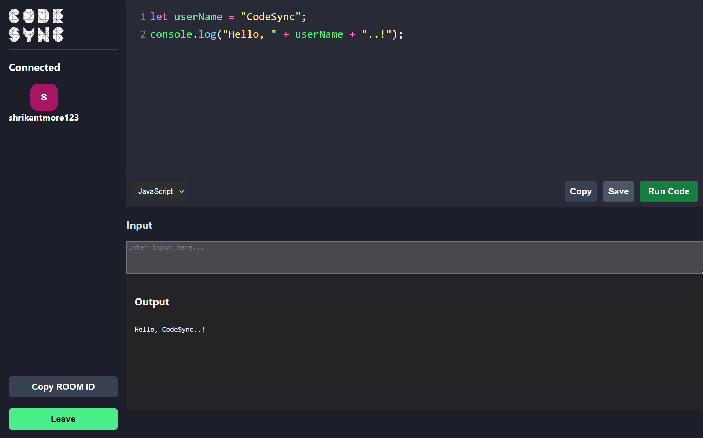

# CodeSync

**CodeSync** is a real-time code collaboration platform that enables developers to work together seamlessly. Whether you're pair programming, conducting a coding interview, or contributing to an open-source project, CodeSync ensures a smooth and synchronized experience.

## Tech Stack

- **React:** A JavaScript library for building user interfaces.

- **Vite:** A fast build tool that provides lightning-fast hot module replacement (HMR).

- **Socket.IO:** For real-time bidirectional event-based communication.

## Features

- Real-time collaborative coding with seamless synchronization

- Multiple developers can edit the same code simultaneously

- Live code updates visible to all connected users

- Run code directly from the editor

- Save code to local file with correct language extension

- Copy entire editor code to clipboard

- Room-based collaboration using a unique Room ID

- Smooth and efficient interface built with React and Vite

## Installation

To get started with the project, clone this repository and follow the steps below:

**Prerequisites**

- Node.js

- npm

**Steps to Install**

1. Clone the repository: 

    ```bash
    git clone https://github.com/Rishabh-Dev-Mishra/Code-Sync.git
    ```

2. Navigate into the project directory:
 
    ```bash
    cd Code-Sync
    ```

3. Install dependencies: 

    ```bash
    npm install
    ```

4. Run the development server:

    ```bash
    npm run dev
    ```

Visit the live app: [Click Here!](https://code-sync-rd.vercel.app/)

## Usage

- Create a new room using a unique Room ID

- Join an existing room using the Room ID

- Collaborate in real time with other users

- Use:

    - Copy to copy the entire editor code

    - Save to download code with language-based file extension

    - Run Code to execute and view output

## Contributing

We welcome contributions to improve CodeSync!

**To contribute:**

- Fork the repository.

- Create a new branch for your changes.

- Submit a pull request with a detailed description of your changes.

## Preview

